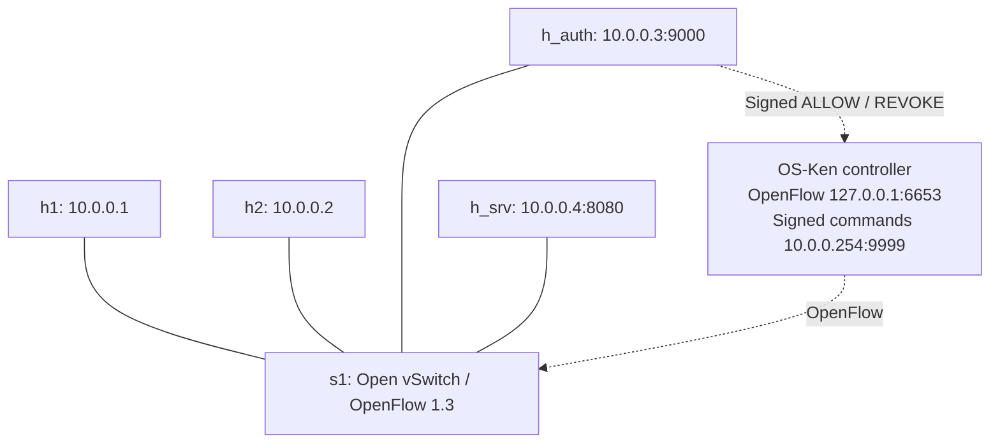

# Simplified project: architecture and submission guide

This guide accompanies the Ubuntu-validated simplified application from 26 October 2026. It adds documentation only; the tested runtime is unchanged. The supplied rubric requires a TCP/UDP socket application integrated with Mininet/SDN, reproducible source/configuration/tests, evaluation against a baseline, and final code/documentation on GitHub. The assigned application uses TCP.

## Problem and objectives

An application login normally decides whether that application will serve a request. This project additionally uses the login to change network access: unauthorized hosts cannot reach a selected TCP service; authenticated hosts receive a temporary permission. Objectives are concurrent TCP authentication, IP-bound sessions, timed access, dynamic rule installation/removal, logs, failure handling and measured comparison with a static rule.

## Architecture and communication

Solid edges are emulated host/switch links; dashed edges are logical control connections. Both h1 and h2 can authenticate: neither is permanently assigned an authorized role. The root namespace reaches the emulated LAN through ctrlroot0/ctrlovs0 at 10.0.0.254. The switch-controller channel and application-controller channel are different TCP connections.

| Component | Implementation | Role |
| --- | --- | --- |
| Topology | topology.py | Four hosts, one switch, controller link, owned-resource cleanup |
| Authentication server | auth_server.py | Credentials, sessions, expiry, IP lockout and access-change requests |
| Controller client | controller_client.py | Signs and sends control commands, requires acknowledgement |
| SDN controller | controller.py | Verifies commands and updates OpenFlow policy |
| User client | client.py | Login, service request, confirmed logout |
| Protected service | protected_service.py | Replies to GET_SECRET; network policy restricts reachability |
| Shared helpers | net_protocol.py, control_security.py | TCP framing/concurrency and HMAC/key validation |

## Protocol and state

The client sends a newline-terminated JSON object such as {"action":"LOGIN","username":"alice","password":"123"}. Success returns ok=true, a random session_id and lease_seconds. LOGOUT supplies the token. The server derives source IP from the TCP connection; a supplied username does not choose the permitted network address.

The service accepts GET_SECRET followed by a newline. Control commands are ALLOW client_ip 10.0.0.4 8080 lease_seconds or REVOKE client_ip 10.0.0.4 8080, carried inside a signed JSON envelope. The controller first sends a fresh nonce/timestamp challenge. HMAC-SHA256 authenticates the command and binds it to that connection; it does not encrypt traffic. Bare commands are rejected.

Worker threads accept concurrent clients. One transition lock serializes session mutations and corresponding switch updates. Successful login commits the session only after switch confirmation. Failed grants trigger best-effort cleanup; unconfirmed revocations remain retryable. Multiple sessions on one source IP share the network grant, so ending one preserves the remaining sessions' access.

| Priority | Match | Effect |
| ---: | --- | --- |
| 200 | Authorized source IPv4, destination 10.0.0.4, TCP port 8080 | NORMAL forwarding with finite hard timeout |
| 100 | Destination 10.0.0.4, TCP port 8080 | Drop |
| 0 | Other traffic | NORMAL forwarding |

Grant cookie 0x53444e4155544801 and strict deletion scope revocation. OpenFlow barriers confirm processing of preceding messages; correlated errors reject failed updates. Service probes separately establish actual reachability. ARP, ICMP and unrelated traffic are allowed by the baseline.

## Configuration and reproduction

Defaults: login lease 60 seconds; lockout after three bad passwords for 60 seconds; expiry sweep every second. AUTH_LEASE_SECONDS and AUTH_LOCKOUT_SECONDS configure the authentication process. AUTH_LOG_FILE selects its log. SDN_CONTROL_SECRET_FILE must point to the same private 0600 key file for authentication and controller processes. SDN_CONTROL_HOST/SDN_CONTROL_ALLOWED_PEER configure the controller listener/peer; SDN_CONTROLLER_HOST/SDN_CONTROLLER_PORT configure its client. Keep endpoint settings consistent; normal demonstration uses defaults.

The tested VM has Ubuntu 26.04, system Python 3.14.4, controller Python 3.11.13, OS-Ken 3.1.1, Mininet 2.3.0 and OVS 3.7.1. Mininet uses system Python; OS-Ken uses .venv311. For a separate new machine, first provision Mininet/OVS and Python 3.11, then create a dedicated environment with python3.11 -m venv .venv311 and install requirements.txt using that interpreter. Fresh-machine provisioning has not been tested; installed VM versions and warnings are recorded in RESULTS.md. Do not reinstall packages into the preserved fallback environment.

On the existing VM use /home/akash/sdn-authentication-simplified. Follow DEMO.md for exact key creation, startup, client commands and shutdown. Startup order is topology, controller, then servers. The original and simplified topologies cannot run simultaneously because they share network names/ports.

## Tests and rubric evidence

| Official criterion | Implementation/documentation and evidence |
| --- | --- |
| Problem understanding and architecture | Problem/objectives above, topology diagram, component roles, protocol and expected policy |
| TCP socket implementation | Low-level socket clients/servers, newline framing, bounded reads, concurrent handlers and error handling |
| Mininet + SDN | topology.py, controller.py; successful connectivity and actual OVS flow snapshots |
| Socket-SDN integration | Login triggers signed ALLOW, logout/expiry triggers REVOKE; forwarding verified after updates |
| Initial testing | Client end-to-end login/access/logout and healthy-service plus default-denial checks |
| Complete functionality | Sessions, tokens, concurrent users, expiry, shared-IP handling and logs |
| Dynamic SDN | Temporary priority-200 rules; removal on logout/expiry; reconnect cleanup |
| Challenging scenario / robustness | Unauthorized access, controller outage, lockout/recovery, malformed/slow input and capacity recovery |
| Performance evaluation and comparison | Fresh 20 dynamic and 20 static trials; raw CSV and data/PERFORMANCE.md |
| Documentation | README.md, this guide, DEMO.md and RESULTS.md; source, configuration and test instructions |
| GitHub submission | This repository publishes the simplified final source and documentation; the original repository remains separate |

The compact suite passed 26 tests in Ubuntu, without skips. The separate verification toolkit passed 75 regression methods and normal/extended live runs with 80/122 checkpoint verdicts. These counts overlap and must not be added as unique tests.

Run the compact suite from app with .venv311/bin/python -B -m unittest discover -s tests -v. The returned bundle's verification directory contains the full regression/live runner and the same runtime source. Its audit_live.py manages a fresh temporary topology, private key, benchmark rule and cleanup. Follow RESULTS.md for exact commands and use a new output directory. Inspect conflicts first; never blindly delete an existing bridge or run broad cleanup. Full verification helpers are supporting material, not additional application modules.

## Experiment and interpretation

The final source-linked batch measures dynamic authentication followed by protected-service access, versus a static source-specific allow rule. Each mode has 20 sequential trials. Service transaction time includes TCP connection, request and response. Dynamic login/control time includes authentication and rule confirmation; login-to-access includes that extra authorization step. Dynamic rows are retained only after logout is confirmed.

| Metric | Mean ms | Median ms |
| --- | ---: | ---: |
| Dynamic login/control | 89.1809 | 68.7180 |
| Dynamic service transaction | 17.5641 | 16.9745 |
| Dynamic login-to-access | 106.8042 | 85.6560 |
| Static service transaction | 14.3079 | 12.5385 |

The static service transaction was faster in this batch. Dynamic authorization supplies revocable access at additional cost; this project does not claim it always improves latency. Sequential mode order, VM load and caches confound causal attribution. All samples/outliers are retained. Use summarize_performance.py with the current CSV to reproduce statistics, as documented in RESULTS.md.

## Boundaries and delivery status

This is a trusted educational network: plaintext public demo passwords/tokens, unsigned control replies, source-IP-based permission, volatile sessions and no IP/ARP anti-spoofing. Existing grants can survive a controller outage until their hard timeout. These are documented scope boundaries, not claims of production security.

The implementation and technical evidence cover the supplied project requirements. Human presentation/viva are outside this completion check. The simplified code is published in this separate repository; the original GitHub repository remains the fallback. Do not mix the original repository's measurements with the simplified version's measurements.
