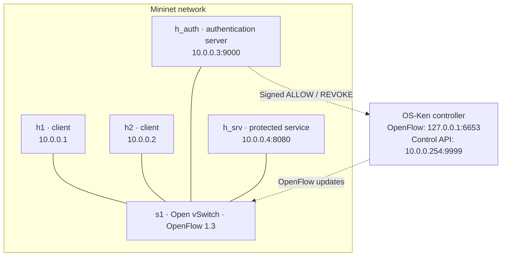

<div align="center">

# SDN Authentication<br>and Dynamic Access Control

**Log in. Unlock network access. Revoke it automatically.**

Python TCP sockets · Mininet · Open vSwitch · OpenFlow 1.3 · OS-Ken

[Architecture](#architecture) · [Get started](#get-started) · [Demo guide](DEMO.md) · [Results](#performance-results) · [Project guide](PROJECT_GUIDE.md)

</div>

---

A Computer Networks project that connects **application authentication to network access control**. A successful TCP login asks the SDN controller to install a temporary switch rule. The authenticated host can then reach a protected service. Logout or session expiry removes that permission.

This is the **simplified edition**, with 11 runtime Python modules and 3 compact test files. The [original repository](https://github.com/Akash-1271/sdn-authentication-dynamic-access-control) is preserved separately.

> **Project status:** Required technical functionality, architecture documentation, test cases, performance comparison and reproduction instructions are implemented and included. Ubuntu validation completed on **26 October 2026**; this edition was published on **27 October 2026**.

## What the project does

| Capability | Behavior |
|---|---|
| TCP authentication | Checks demo credentials and returns an IP-bound session token |
| Concurrent clients | Handles multiple connections with bounded worker threads |
| Temporary access | Installs a source-specific grant with a default 60-second lease |
| Dynamic revocation | Removes access on logout or expiry; preserves other active sessions on the same IP |
| Failed-login protection | Locks a source IP for 60 seconds after three incorrect passwords |
| Authenticated control | Uses HMAC-SHA256 and a fresh challenge for controller requests |
| Failure handling | Rejects unconfirmed updates, retries revocation and limits grants with hard timeouts |
| Evaluation | Compares dynamic authentication/access against a static-rule baseline |

## Architecture



Solid lines represent emulated network links; dashed arrows represent logical control channels. Both clients can authenticate. The controller's root namespace connects to the emulated LAN through `ctrlroot0` / `ctrlovs0` at `10.0.0.254`.

**Port 9000** handles user authentication, **8080** serves protected data, **9999** carries application-to-controller commands, and **6653** carries OpenFlow.

### From login to network access

1. **Before login:** the switch drops TCP traffic to the protected service.
2. **Authenticate:** the client sends a newline-terminated JSON login request.
3. **Authorize:** the authentication server sends a signed `ALLOW` command for the client's observed source IP.
4. **Install:** the controller installs a finite grant and waits for a switch barrier reply, checking correlated errors.
5. **Access:** the server commits the session and returns a token; the client requests protected data.
6. **Revoke:** logout or expiry removes the grant, unless another active session on the same IP still needs it.

A barrier confirms processing of preceding switch messages. Live service probes separately verify that forwarding behaves correctly.

### Switch policy

| Priority | Match | Action |
|---:|---|---|
| **200** | Authorized source IP → `10.0.0.4`, TCP destination port `8080` | Temporary `NORMAL` forwarding |
| **100** | Any source → `10.0.0.4`, TCP destination port `8080` | Drop |
| **0** | Other traffic | `NORMAL` forwarding |

ARP, ICMP and unrelated traffic can pass. A finite OpenFlow `hard_timeout` limits the grant even if an application process stops. Cookie-scoped strict deletion targets this project's grants.

## Get started

**Run the network demonstration inside Ubuntu, not Windows.** You need Mininet, an active Open vSwitch service, system Python with Mininet available, and Python 3.11 for the controller environment.

### Existing tested VM

Use the already validated directory:

```bash
cd /home/akash/sdn-authentication-simplified
```

Keep its working environment. Follow [DEMO.md](DEMO.md) for exact terminal-by-terminal commands, private key setup and shutdown.

### Fresh checkout on a provisioned Ubuntu machine

```bash
git clone https://github.com/Akash-1271/sdn-authentication-dynamic-access-control-simplified.git
cd sdn-authentication-dynamic-access-control-simplified
python3.11 -m venv .venv311
.venv311/bin/python -m pip install -r requirements.txt
.venv311/bin/python -m pip check
```

The demo guide uses the existing VM path; substitute your checkout path when using a new clone. Fresh-machine provisioning has not been independently validated. Do not reinstall packages into the preserved original project's environment.

### Startup order

| Where | Start |
|---|---|
| Ubuntu terminal A | Mininet topology |
| Ubuntu terminal B | OS-Ken controller |
| Terminal A, at `mininet>` | Authentication server and protected service |
| Terminal A, at `mininet>` | Client and demonstration checks |

The topology must create the management address before the controller binds its listener. Both servers and the controller use the private key configuration described in [DEMO.md](DEMO.md). The original and simplified networks cannot run simultaneously with the same bridge names and ports.

<details>
<summary><strong>Tested environment and configuration</strong></summary>

| Component | Validated version |
|---|---|
| Ubuntu | 26.04 LTS |
| System Python | 3.14.4 |
| Controller Python | 3.11.13 |
| OS-Ken | 3.1.1 |
| Mininet | 2.3.0 |
| Open vSwitch | 3.7.1 |
| Eventlet | 0.41.2 |

`requirements.txt` pins OS-Ken; it is not a complete system/transitive dependency lock. Recorded Eventlet deprecation/unpatched-RLock warnings remain documented.

| Setting | Purpose / default |
|---|---|
| `SDN_CONTROL_SECRET_FILE` | Required path to the shared private control key |
| `AUTH_LOG_FILE` | Authentication/access log path; defaults to `security.log` |
| `AUTH_LEASE_SECONDS` | Session lease; default `60` |
| `AUTH_LOCKOUT_SECONDS` | Failed-login lockout duration; default `60` |
| `SDN_CONTROL_HOST` | Controller command listener; default `10.0.0.254` |
| `SDN_CONTROL_ALLOWED_PEER` | Permitted command peer; default `10.0.0.3` |

The key generator creates a private mode-`0600` file and refuses to overwrite one. Keep it outside the repository. Public lab accounts are `alice / 123` and `bob / 456`; they are deliberately non-secret demonstration credentials.

</details>

## Demonstration

After starting the network and servers, these are the main commands **at the Mininet prompt**:

```text
h_srv python3 -B demo_checks.py service
h1 python3 -B demo_checks.py denied
h1 python3 -B client.py
h1 python3 -B demo_checks.py expiry
h1 python3 -B demo_checks.py concurrent
h2 python3 -B demo_checks.py lockout --recover
```

`client.py` demonstrates login → protected access → logout. The expiry and lockout checks each wait roughly one minute with the default settings.

**A timeout alone does not prove denial.** The denial/expiry probe deliberately reports `INCONCLUSIVE` with exit code 2 for a timeout. Pair it with a healthy service and a switch table showing the priority-100 drop rule without a matching priority-200 grant.

See the [10–15 minute demo guide](DEMO.md) for flow inspection, controller-failure checks, expected observations and owned-process cleanup.

## Validation

| Ubuntu validation, 26 October 2026 | Result |
|---|---|
| Compact application/protocol/controller suite | **26 passed, zero skipped** |
| Separate extended regression suite | **75 passed, zero skipped** |
| Normal Mininet integration run | **80 checkpoint verdicts passed** |
| Extended integration run | **122 checkpoint verdicts passed** |
| Automated CLI rehearsal | Login/logout, default expiry, concurrency, lockout recovery and controller failure exercised |
| Performance data | **20 dynamic + 20 static trials** |

These are recorded Ubuntu results, not a continuously running CI badge. Suites and live checkpoints overlap; do not add them as independent test counts. Failed attempts and verification-harness repairs are disclosed in [RESULTS.md](RESULTS.md).

Run the compact suite from the project root:

```bash
PYTHONDONTWRITEBYTECODE=1 .venv311/bin/python -B -m unittest discover -s tests -v
```

Windows can run the portable tests; OS-Ken controller tests need the Ubuntu environment. Full regression and live-runner source is retained in the optional [verification toolkit](verification/README.md), separately from the main project files. Raw machine logs and private runtime material are not published.

## Performance results

The experiment compares **dynamic login and access** with an installed **static allow rule**, using 20 sequential trials per mode.

| Metric | Mean (ms) | Median (ms) |
|---|---:|---:|
| Dynamic login/control | 89.1809 | 68.7180 |
| Dynamic service transaction | 17.5641 | 16.9745 |
| Dynamic login-to-access | 106.8042 | 85.6560 |
| Static service transaction | 14.3079 | 12.5385 |

Compare **service transaction time** across modes: it includes TCP connection setup, request and response. Dynamic login/control adds authorization work; comparing dynamic login-to-access directly against static service time would mix different operations.

The static baseline was faster in this batch. Dynamic access provides temporary, revocable permissions at additional cost. VM load, cache effects and sequential mode order affect measurements, so this is not a universal speed claim. All samples and outliers are retained.

[Raw measurements](data/performance_results_current.csv) · [Full statistics](data/PERFORMANCE.md) · [Tested source hashes](data/runtime_source_manifest.json)

Reproduce the summary:

```bash
python3 summarize_performance.py data/performance_results_current.csv   --label "Ubuntu simplified edition; see data/runtime_source_manifest.json"
```

For new measurements, use the [verification runner](verification/README.md), which installs and removes the baseline rule and records fresh outputs.

## Five files to understand first

| File | Responsibility |
|---|---|
| [topology.py](topology.py) | Builds the four-host network, switch and management link |
| [auth_server.py](auth_server.py) | Credentials, sessions, lockout, expiry and access-change requests |
| [controller.py](controller.py) | Verifies control requests and installs/removes OpenFlow rules |
| [client.py](client.py) | Performs login, service request and logout |
| [protected_service.py](protected_service.py) | Answers TCP requests; the switch restricts reachability |

<details>
<summary><strong>Supporting files and repository layout</strong></summary>

| File / directory | Purpose |
|---|---|
| `controller_client.py` | Sends signed control commands and checks acknowledgements |
| `control_security.py` | HMAC challenge verification and private key handling |
| `net_protocol.py` | Bounded TCP framing, strict JSON and concurrent connection handling |
| `demo_checks.py` | Focused live demonstration scenarios |
| `performance_test.py` | Dynamic/static measurements |
| `summarize_performance.py` | CSV validation and statistics |
| `tests/` | Three compact test modules |
| `data/` | Measurements, generated report and runtime hashes |
| `verification/` | Optional extended test archive and reproduction instructions |
| `requirements.txt` | Controller dependency |
| `.gitignore` | Excludes local environments, secrets and generated files |

The optional archive contains additional test helpers and copies of the validated runtime for regression reproduction. Those helpers are not required to run the application.

</details>

## Design choices and boundaries

- **TCP framing:** newline delimiters, size limits and deadlines prevent unbounded reads.
- **Concurrency:** worker threads accept clients; one transition lock serializes session state and its switch updates.
- **Control integrity:** HMAC and per-connection challenges reject forged or replayed requests; HMAC does not provide encryption.
- **Failure recovery:** failed grants trigger best-effort rollback; failed revocations remain retryable.
- **Logging:** authentication and access changes are recorded without printing private keys or session tokens.

This is a trusted educational lab. Credentials and tokens travel without TLS; permission is per source IP, so users on one host share network access. Sessions are in memory. IP/ARP anti-spoofing and signed controller replies are outside this implementation.

Existing grants can remain during controller failure until their finite timeout. Switch acknowledgements and rollback do not make updates an atomic distributed transaction. These scope limits are documented rather than presented as production-security guarantees.

## Documentation

| Guide | What it covers |
|---|---|
| [Project guide](PROJECT_GUIDE.md) | Objectives, architecture, protocol, configuration and rubric-to-evidence mapping |
| [Demo guide](DEMO.md) | Exact Ubuntu/Mininet steps and expected observations |
| [Validation record](RESULTS.md) | Executed gates, environment, repairs, provenance and limitations |
| [Performance report](data/PERFORMANCE.md) | Statistics, ranges and retained outliers |
| [Verification toolkit](verification/README.md) | Optional full regression and live-run reproduction |

The repository includes the required technical deliverables: source, topology, configuration, test cases, architecture, documented evaluation and reproduction instructions. Individual demonstration and viva remain separate assessment activities.
