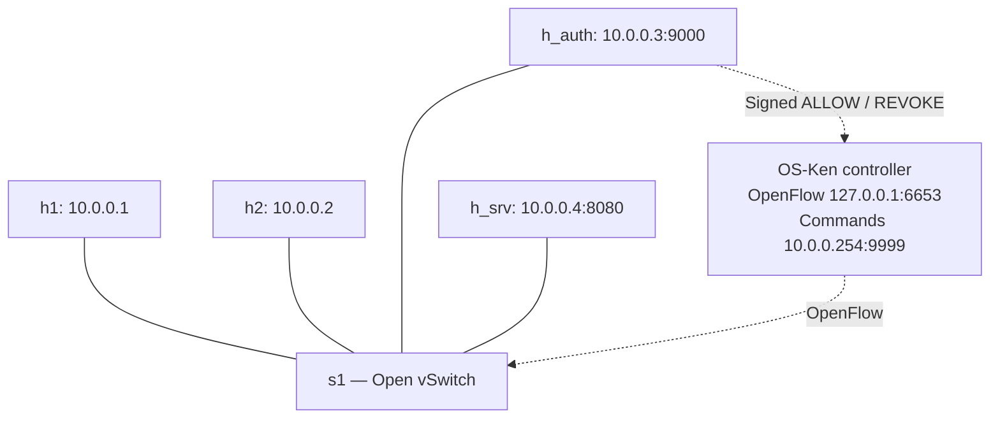

# SDN Authentication and Dynamic Access Control

**TCP login → temporary network access → logout or automatic expiry**

Python sockets · Mininet · Open vSwitch · OpenFlow 1.3 · OS-Ken

[Demo steps](DEMO.md) · [Tests and results](RESULTS.md) · [Performance](data/PERFORMANCE.md)

> Validated in Ubuntu on 29 October 2026: 27 compact and 75 original regression tests passed without skips, followed by real Mininet checks and an automated demo rehearsal. Both earlier projects remain available unchanged.

## What it does

A host must authenticate before reaching a protected TCP service. A successful login asks the SDN controller to allow that host's IP for 60 seconds. Logout or expiry removes access. Multiple clients can log in, and three incorrect passwords temporarily lock that source IP.

## Architecture



Solid lines are network links; dashed arrows are logical control connections. Both h1 and h2 can authenticate. A management link connects the controller to the emulated LAN at 10.0.0.254.

1. The switch initially blocks TCP access to 10.0.0.4:8080.
2. A client sends a newline-terminated JSON login to the authentication server.
3. The server checks credentials and requests a signed ALLOW for the observed source IP.
4. The controller installs a finite rule and checks the switch's acknowledgement/errors.
5. The server returns an IP-bound session token. The host can access the service.
6. Logout or expiry triggers REVOKE. Another active session on the same IP retains access.

| Priority | Traffic | Action |
|---:|---|---|
| 200 | Authenticated source → protected service | Temporary allow |
| 100 | Other sources → protected service | Drop |
| 0 | Other traffic, including ARP and ping | Normal forwarding |

## Five main files

| File | Responsibility |
|---|---|
| topology.py | Four Mininet hosts, one switch and the management link |
| auth_server.py | Credentials, sessions, lockout, expiry and access changes |
| controller.py | Signed command verification and OpenFlow rules |
| client.py | Login, service request and logout |
| protected_service.py | TCP service protected by the switch |

Supporting code: controller_client.py sends ALLOW/REVOKE; control_security.py handles HMAC/key checks; net_protocol.py shares TCP framing, request/reply and threaded serving. demo_checks.py holds demo scenarios. performance_test.py and summarize_performance.py measure and summarize results. The tests/ directory has three test modules.

## Run in Ubuntu

On the existing VM, use `/home/akash/sdn-final-simplified-20261029`. Follow [DEMO.md](DEMO.md) for exact startup, key configuration and cleanup. Startup order is **topology → controller → servers → client**.

On a new, already provisioned Ubuntu machine, install Mininet/OVS and make Mininet available to system Python. Create a dedicated controller environment:

```bash
git clone https://github.com/Akash-1271/sdn-authentication-dynamic-access-control-simplified.git
cd sdn-authentication-dynamic-access-control-simplified
python3.11 -m venv .venv311
.venv311/bin/python -m pip install -r requirements.txt
.venv311/bin/python -m pip check
PYTHONDONTWRITEBYTECODE=1 .venv311/bin/python -B -m unittest discover -s tests -v
```

For a fresh clone, replace the absolute project path in DEMO.md with your checkout path. The guide also explains the private key path and startup commands.

The controller and auth server require the same private 0600 key through SDN_CONTROL_SECRET_FILE. Generate it outside the repository using control_security.py --generate-key PATH. Demo accounts alice/123 and bob/456 are public lab accounts.

AUTH_LEASE_SECONDS and AUTH_LOCKOUT_SECONDS default to 60. AUTH_LOG_FILE selects the authentication/access log. TCP messages have size and deadline limits. Worker threads accept concurrent clients; one state lock coordinates session changes with switch updates.

## Evaluation and scope

Compare service transaction time for 20 dynamic and 20 static trials. Report login/control overhead separately. Keep all raw samples, mean, median and outliers. The [previous validated results](data/reference-20261026/PERFORMANCE.md) are reference measurements; the fresh final-source batch is in [data/PERFORMANCE.md](data/PERFORMANCE.md).

HMAC authenticates control requests but does not encrypt them. This trusted lab uses plaintext demo credentials/tokens, volatile sessions and source-IP permissions. Users on one host share network access. No IP/ARP anti-spoofing is implemented. Existing grants can survive controller failure until their hard timeout; failed revocations are retryable.

The project covers TCP authentication, concurrency, sessions/timeouts, dynamic SDN policies, logs, unauthorized-access tests, robustness and baseline evaluation. [RESULTS.md](RESULTS.md) maps requirements to evidence. Extended regression/live tooling is retained under [verification/](verification/README.md).
